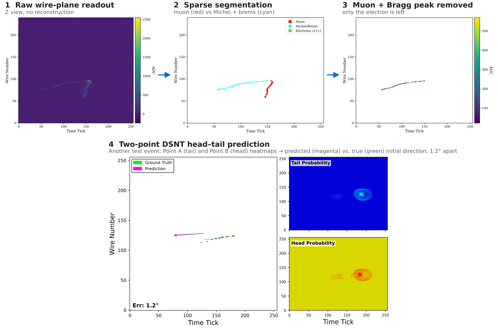

# lartpc-supernova-pointing
Physics-informed electron direction reconstruction for supernova neutrino pointing. Running on raw Liquid Argon Time Projection Chamber (LArTPC) readouts, with muon removal, two-point DSNT coordinate prediction, and multi-view detector geometry.
<!-- <h1 align="center">LArPOINT</h1>

  <strong>Electron directional reconstruction for supernova neutrino pointing</strong>

  Raw LArTPC readout · Physics-informed learning · Multi-view geometry

 -->

  Hilary Utaegbulam

## Overview

**This project investigates how the initial direction of a low-energy electron can be inferred from raw liquid argon time projection chamber (LArTPC) readout images, in an attempt to resolve head-tail ambiguiity.** The goal is to support supernova neutrino pointing through improved electron head–tail reconstruction.

The project investigates its approach using simulated Integrated Cryostat and Electronics Built for Experimental Research Goals (ICEBERG) events of Michel electrons from stopping cosmic muons. Learned segmentation and local charge suppression are used to remove the parent-muon's track before a physics-informed model estimates the electron direction in each wire-plane view.

## Demonstration

The overview figure shows simulated ICEBERG readout processing and an example of two-point direction prediction. The upper sequence shows particle segmentation and muon/Bragg-peak suppression. The lower panels show a different event, including the predicted direction and the DSNT spatial distributions.

## Scope

This repository presents the research method, implementation, coordinate transformations, and selected simulation results.

“Raw readout” refers to the ADC image representation used by the analysis. The demonstrated sample consists of simulated ICEBERG events, and the work focuses on electron directional reconstruction relevant to supernova pointing.

## License

Code is available under the [MIT License](LICENSE).
