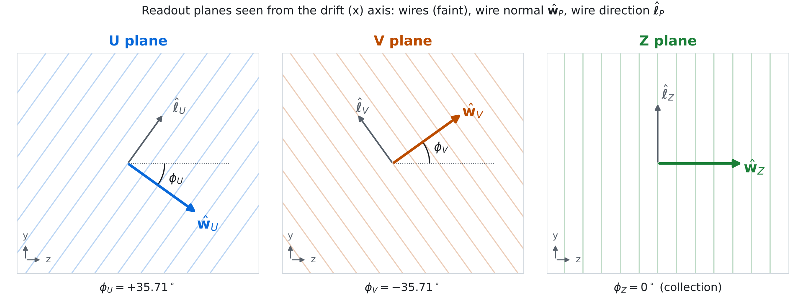
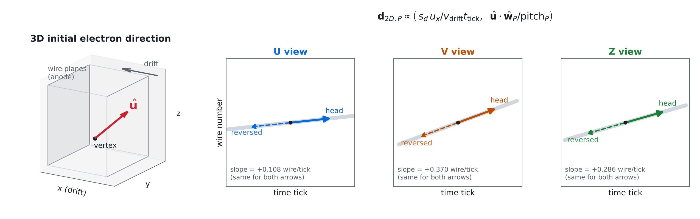
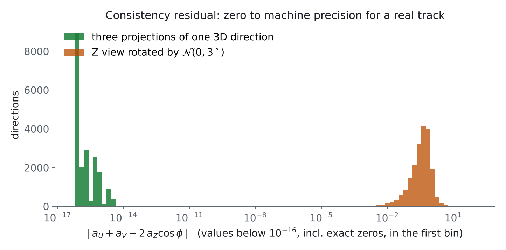
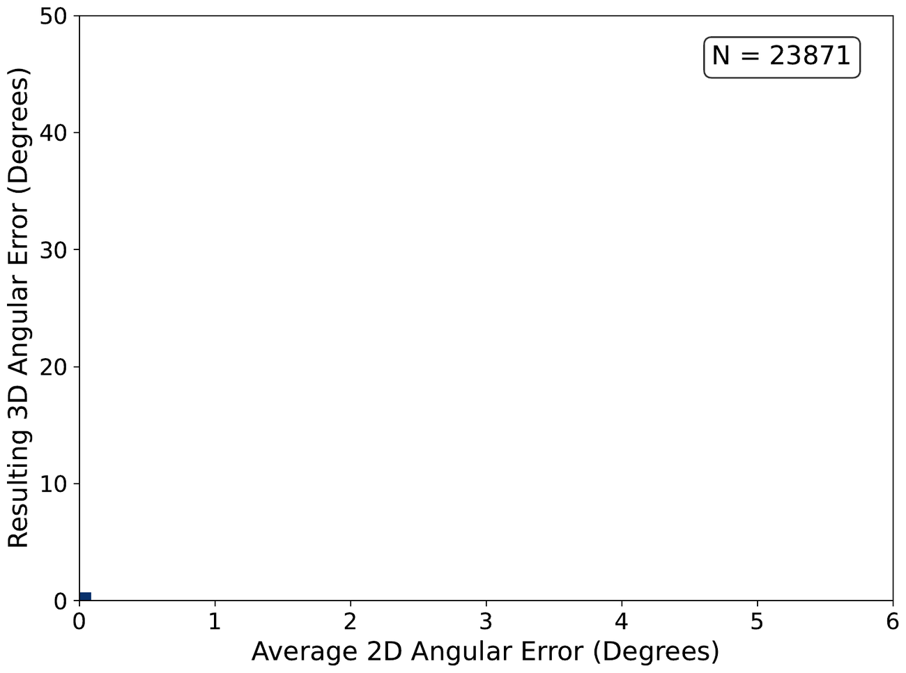
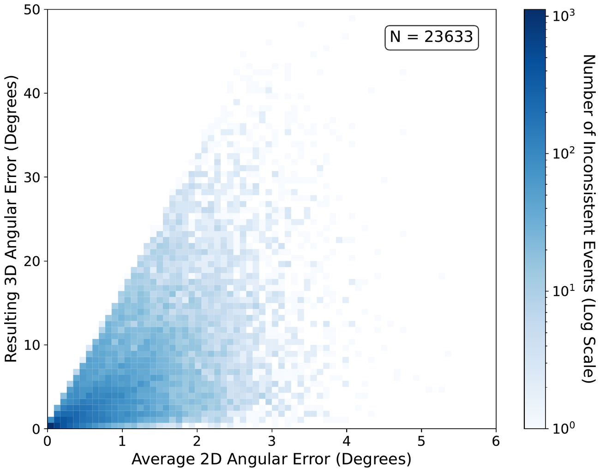
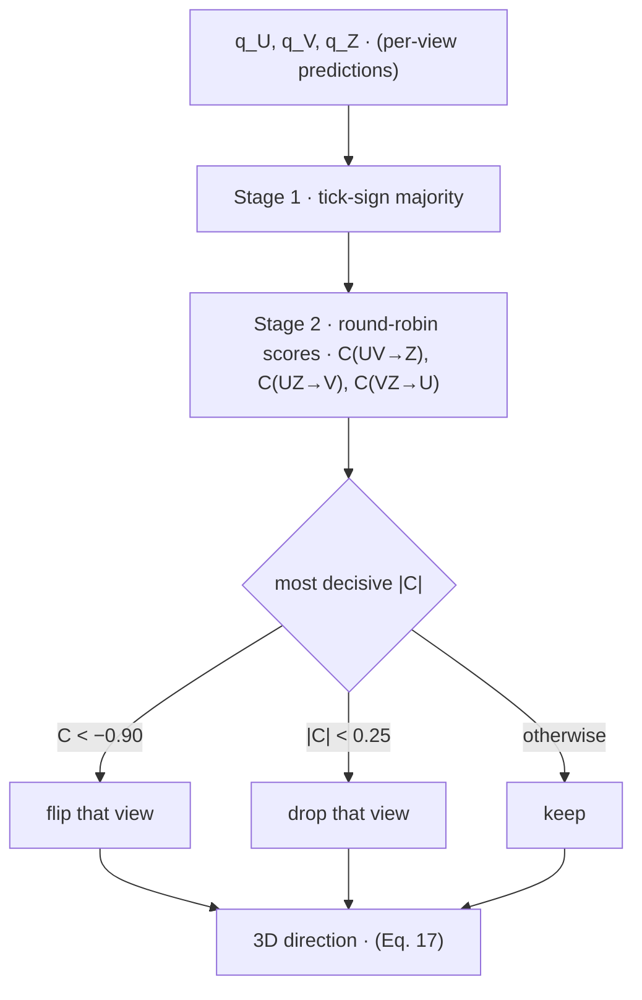

# Coordinate transformations: 3D ⇄ 2D wire-plane views
 
Wire-plane LArTPC readouts are projections of a complete 3D trajectory. Each readout plane records a **2D image**, time tick on one axis, wire number on the other. The head–tail model predicts a direction in each of those images.
 
* **3D → 2D** to map the true initial electron momentum to each wire plane. This serves as the ground truth training target in every view.
* **2D → 3D** used to reconstruct a detector-space direction from two nondegenerate wire plane directions, with a third view providing redundancy. The same algebra yields a **consistency condition** that the three views must satisfy, and that condition drives the voting system that is introduced later.
Everything on this page is implemented in [`larpoint/geometry.py`](../larpoint/geometry.py) (pure NumPy) and checked in [`tests/test_geometry.py`](../tests/test_geometry.py). The figures are drawn from that module by [`tools/make_geometry_figures.py`](../tools/make_geometry_figures.py).
 
**Contents**
1. [Detector frame and conventions](#1-detector-frame-and-conventions)
2. [Forward map: 3D → 2D](#2-forward-map-3d--2d)
3. [The U/V/Z consistency condition](#3-the-uvz-consistency-condition)
4. [Inverse map: two views → 3D](#4-inverse-map-two-views--3d)
5. [The voting system](#5-the-voting-system)
6. [Equation → code map](#6-equation--code-map)
---
 
## 1. Detector frame and conventions
 
The wire planes lie parallel to the global `yz`-plane, and ionization electrons drift along `x`. Time tick measures position along `x`, and wire number measures position *across the wires* within the `yz`-plane.
 
<p align="center"></p>
For each plane $`P \in \{U, V, Z\}`$ there are two in-plane unit vectors. $`\boldsymbol{\hat{\ell}}_P`$ runs **along** the wires. $`\hat{\mathbf{w}}_P`$ runs **across** them and points toward increasing wire index:
 
```math
\begin{gathered}
\hat{\mathbf{w}}_P = \left(0,\; -\sin\phi_P,\; \cos\phi_P\right),
\qquad
\hat{\boldsymbol{\ell}}_P = \left(0,\; \cos\phi_P,\; \sin\phi_P\right),
\qquad
\phi_Z = 0^\circ,\;\; \phi_U = +35.71^\circ,\;\; \phi_V = -35.71^\circ .
\end{gathered}
\tag{1}
```
 
The direction of increasing time tick is
 
```math
\begin{gathered}
\hat{\mathbf{d}} = s_d\,\hat{\mathbf{x}},
\qquad
s_d =
\begin{cases}
+1 & \text{TPC 1} \\
-1 & \text{TPC 0}
\end{cases}
\end{gathered}
\tag{2}
```
 
With the TPC-dependent image convention used here, the same physical $`+x`$ step moves *forward* in time in one TPC and *backward* in the other. The drift sign $`s_d`$ only affects the tick axis. 
 
| Symbol | Meaning | ICEBERG value |
|---|---|---|
| $`v_{\rm drift}`$ | bulk electron drift speed | $`1.60\times10^{-4}`$ cm/ns |
| $`t_{\rm tick}`$ | ADC sampling period | 500 ns |
| $`v_{\rm drift}\,t_{\rm tick}`$ | drift distance per tick | 0.080 cm |
| $`\mathrm{pitch}_Z`$ | collection wire pitch | 0.479 cm |
| $`\mathrm{pitch}_{U,V}`$ | induction wire pitch | 0.4667 cm |
 
> **Images are anisotropic.** One tick is 0.8 mm of drift, while one wire is about 4.7 mm across the wires. An angle in a (tick, wire) image is first converted through the physical constants. 
 
---
 
## 2. Forward map: 3D → 2D
 
Start from the true initial Michel momentum $`\mathbf{p}=(p_x,p_y,p_z)`$, taken as close to the muon–Michel decay vertex as possible (before multiple Coulomb scattering bends the track). Near the vertex, the electron track is treated as a straight line parameterized by path length $`s`$ (in cm):
 
```math
\begin{gathered}
\hat{\mathbf{u}} = \frac{\mathbf{p}}{\lVert\mathbf{p}\rVert} = (u_x, u_y, u_z),
\qquad
\mathbf{r}(s) = \mathbf{r}_0 + s\,\hat{\mathbf{u}},
\qquad
d\mathbf{r} = \hat{\mathbf{u}}\,ds .
\end{gathered}
\tag{3}
```
 
A step $`d\mathbf{r}`$ has a component along the drift axis, which sets the time coordinate, and a component across the wires, which sets the wire index. Each component is divided by its physical scale:
 
```math
\begin{gathered}
\frac{d(\text{ticks})}{ds}
= \frac{\hat{\mathbf{u}}\cdot\hat{\mathbf{d}}}{v_{\rm drift}\,t_{\rm tick}}
= \frac{s_d\,u_x}{v_{\rm drift}\,t_{\rm tick}},
\qquad
\frac{d(\text{wires})}{ds}
= \frac{\hat{\mathbf{u}}\cdot\hat{\mathbf{w}}_P}{\mathrm{pitch}_P}
= \frac{-u_y\sin\phi_P + u_z\cos\phi_P}{\mathrm{pitch}_P}.
\end{gathered}
\tag{4}
```
 
Together they give the **projected direction in plane $`P`$**, (tick, wire):
 
```math
\boxed{\;
\mathbf{d}_{2D,P} =
\begin{bmatrix}
\dfrac{s_d\,u_x}{v_{\rm drift}\,t_{\rm tick}} \\[10pt]
\dfrac{-u_y\sin\phi_P + u_z\cos\phi_P}{\mathrm{pitch}_P}
\end{bmatrix}
\;}
\tag{5}
```
 
Normalizing $`\mathbf{d}_{2D,P}`$ gives the unit target vector $`\hat{\mathbf{u}}_{{\rm true},P}`$ that the head–tail model is trained against in each view.
 
<p align="center"></p>
### Slope
 
The ratio of the two components is the projected slope in wires per tick. Collecting the constants into a plane factor $`\kappa_P`$:
 
```math
\begin{gathered}
\left(\frac{d(\text{wires})}{d(\text{ticks})}\right)_P
= \kappa_P\,\frac{-u_y\sin\phi_P + u_z\cos\phi_P}{s_d\,u_x},
\qquad
\kappa_P \equiv \frac{v_{\rm drift}\,t_{\rm tick}}{\mathrm{pitch}_P}
\;\;\bigl(\kappa_Z = 0.167,\;\; \kappa_{U,V} = 0.171\bigr).
\end{gathered}
\tag{6}
```
 
Starting at the truth pixel $`(t_{0,P},\,w_{0,P})`$ nearest the decay vertex gives the local line of the initial direction in each image:
 
```math
\begin{gathered}
w \;\approx\; w_{0,P} + \left(\frac{d(\text{wires})}{d(\text{ticks})}\right)_P (t - t_{0,P}).
\end{gathered}
\tag{7}
```
 
The slope is unchanged by $`\hat{\mathbf{u}} \to -\hat{\mathbf{u}}`$. Both components of Eq. (5) change sign, and their ratio does not. A slope fixes the axis of the track but not which end is the head. The dashed arrows in the figure above show this. They share the slope but point the opposite way. This is the head–tail ambiguity in its simplest form. It is also why the model used in this project regresses two points, Point A and Point B, and not an angle or a slope. The signed vector $`\mathbf{r}_B-\mathbf{r}_A`$ carries an orientation that can be checked with the ground truth. Constant timing offsets between planes shift $`t_{0,P}`$ but never change the direction.
 
---
 
## 3. The U/V/Z consistency condition
 
For three ordinary orthogonal projections of a 3D vector, the slopes satisfy $`m_{xz} = m_{yz}\,m_{xy}`$ when the denominators are nonzero. Wire planes have an analogous constraint! Removing the plane factor from Eq. (6) gives a normalized slope that depends only on the 3D direction and the wire angle:
 
```math
\begin{gathered}
a_P \;\equiv\; \frac{1}{\kappa_P}\left(\frac{d(\text{wires})}{d(\text{ticks})}\right)_P
= \frac{-u_y\sin\phi_P + u_z\cos\phi_P}{s_d\,u_x}.
\end{gathered}
\tag{8}
```
 
With the symmetric wire-angle parameterization used here $`\phi_Z = 0`$ and $`\phi_U = -\phi_V \equiv \phi`$:
 
```math
\begin{gathered}
a_Z = \frac{u_z}{s_d u_x},
\qquad
a_U = \frac{-u_y\sin\phi + u_z\cos\phi}{s_d u_x},
\qquad
a_V = \frac{+u_y\sin\phi + u_z\cos\phi}{s_d u_x}.
\end{gathered}
\tag{9}
```
 
The induction planes are mirror images, so their $`u_y`$ terms are equal and opposite. Adding them cancels $`u_y`$ and leaves exactly $`2\cos\phi`$ times the collection-plane slope:
 
```math
\boxed{\; a_U + a_V = 2\,a_Z\cos\phi \;}
\tag{10}
```
 
For nonzero tick components, three projections of a single straight 3D direction satisfy Eq. (10). The model(s) presented in this project return separate per-view predictions that need not satisfy this relation exactly. If their normalized slopes violate Eq. (10), then no single 3D line gives all three predictions. 
 
<p align="center"></p>
In a toy study, the three projections of random 3D directions were perturbed by only $`\sigma = 3^\circ`$ in one or two views. A least-squares (SVD) fit then returned 3D directions tens of degrees off:
 
| Consistent projections | One or two views perturbed by $`\mathcal{N}(0, 3^\circ)`$ |
|:---:|:---:|
|  |  |
 
The toy examples make it clear that small 2D errors can be amplified by the inverse mapping, especially for poorly constrained geometries. Voting is one way to address the disagreements between model outputs. But it does not always work.
 
---
 
## 4. Inverse map: two views → 3D
 
Each plane prediction is a directed image displacement $`\mathbf{q}_P = (\Delta t_P,\, \Delta w_P) = \mathbf{r}_{B,P} - \mathbf{r}_{A,P}`$. Write $`\mathbf{n}_P = (n_{P,y}, n_{P,z}) = (-\sin\phi_P,\, \cos\phi_P)`$ for the $`yz`$ part of $`\hat{\mathbf{w}}_P`$, and define two unknowns
 
```math
\begin{gathered}
b_y = \frac{u_y}{s_d\,u_x},
\qquad
b_z = \frac{u_z}{s_d\,u_x}.
\end{gathered}
\tag{11}
```
 
Eq. (8) then says that every plane contributes **one linear equation**:
 
```math
\begin{gathered}
a_P = \frac{1}{\kappa_P}\frac{\Delta w_P}{\Delta t_P} = n_{P,y}\,b_y + n_{P,z}\,b_z .
\end{gathered}
\tag{12}
```
 
Two non-parallel planes $`(P, Q)`$ give a $`2\times2`$ system with a closed-form solution:
 
```math
\begin{gathered}
\begin{bmatrix} n_{P,y} & n_{P,z} \\ n_{Q,y} & n_{Q,z} \end{bmatrix}
\begin{bmatrix} b_y \\ b_z \end{bmatrix}
=
\begin{bmatrix} a_P \\ a_Q \end{bmatrix}
\\[8pt]
\Longrightarrow\quad
b_y = \frac{n_{Q,z}\,a_P - n_{P,z}\,a_Q}{\det},
\qquad
b_z = \frac{n_{P,y}\,a_Q - n_{Q,y}\,a_P}{\det},
\qquad
\det = n_{P,y}n_{Q,z} - n_{Q,y}n_{P,z}.
\end{gathered}
\tag{13}
```
 
That return a 3D line, but the orientation $`\eta = \pm 1`$ is still undetermined:
 
```math
\begin{gathered}
\hat{\mathbf{u}}^{3D}_{PQ} = \eta_{PQ}\,\frac{(1,\; s_d b_y,\; s_d b_z)}{\sqrt{1 + b_y^2 + b_z^2}},
\qquad \eta_{PQ}\in\{-1,+1\}.
\end{gathered}
\tag{14}
```
 
To choose $`\eta`$, forward-project the candidate with Eq. (5), writing $`\hat{\boldsymbol{\pi}}_P(\mathbf{u})`$ for the unit-normalized projection into plane $`P`$, then keep the sign that best agrees with the two signed inputs:
 
```math
\begin{gathered}
\eta_{PQ} = \mathop{\mathrm{arg\,max}}\limits_{\eta=\pm1}\;
\left[
\hat{\mathbf{q}}_P\cdot\hat{\boldsymbol{\pi}}_P\!\left(\eta\,\mathbf{u}\right)
+
\hat{\mathbf{q}}_Q\cdot\hat{\boldsymbol{\pi}}_Q\!\left(\eta\,\mathbf{u}\right)
\right].
\end{gathered}
\tag{15}
```
 
Projecting $`\hat{\mathbf{u}}^{3D}_{PQ}`$ into the third, held-out plane $`R`$ and comparing with that plane's own prediction gives a consistency score:
 
```math
\begin{gathered}
C_{PQ\rightarrow R} = \hat{\mathbf{q}}_R \cdot \hat{\boldsymbol{\pi}}_R\!\left(\hat{\mathbf{u}}^{3D}_{PQ}\right) \in [-1, 1].
\end{gathered}
\tag{16}
```
 
$`C`$ measures agreement. $`C \approx +1`$ means R agrees with the other two. $`C \approx -1`$ means R has the same axis but the opposite head–tail. $`C \approx 0`$ means that R and what is expected from the other two are nearly orthogonal.
 
The slope form becomes ill-conditioned as $`\Delta t_P \to 0`$. This corresponds to a small drift-direction component. The exact zero-tick case does not work for the voting system method shown below.
 
---
 
## 5. The voting system
 
Three views give three pairwise reconstructions: $`(U,V)\to Z`$, $`(U,Z)\to V`$, and $`(V,Z)\to U`$. The voting system uses that redundancy to repair head–tail disagreements before the final 3D direction is selected.
 

 
**Stage 1: tick-sign majority.** The time-tick axis is shared by all three planes, so a real track has the same sign of $`\Delta t`$ in every view. A non-zero $`\Delta t_P`$ from one view that disagrees with the others has both of its components multiplied by $`-1`$. 
 
**Stage 2: round-robin consistency.** Compute the three held-out scores of Eq. (16) and select the one with the largest $`|C|`$. Flip it if $`C < -0.90`$ and drop it if $`|C| < 0.25`$. These thresholds can and should be tuned. 
 
**3D direction.** Average the pairwise unit directions of the corrected views and normalize:
 
```math
\begin{gathered}
\hat{\mathbf{u}}^{3D}_{\rm reco} =
\frac{\hat{\mathbf{u}}^{3D}_{UV} + \hat{\mathbf{u}}^{3D}_{UZ} + \hat{\mathbf{u}}^{3D}_{VZ}}
{\left\lVert \hat{\mathbf{u}}^{3D}_{UV} + \hat{\mathbf{u}}^{3D}_{UZ} + \hat{\mathbf{u}}^{3D}_{VZ} \right\rVert}.
\end{gathered}
\tag{17}
```
 
In the drop-aware version, a dropped view removes the two pairs that use it, so only the remaining pair is used. If two or more views are dropped, no 3D direction is assigned.
 
> Voting only corrects disagreement. If all three views are wrong in the same way, the event cannot be distinguished from one where all three are right. 
 
---
 
## 6. Equation → code map
 
| Eq. | Quantity | NumPy reference ([`larpoint/geometry.py`](../larpoint/geometry.py)) | PyTorch (used in training / inference) |
|:---:|---|---|---|
| 1 | $`\hat{\mathbf{w}}_P`$, $`\hat{\boldsymbol{\ell}}_P`$ | `wire_normal`, `wire_direction` | `_n_perp_from_theta_deg` in `headtail/physics_utils.py` |
| 2 | drift sign $`s_d`$ | `drift_sign` | `headtail/dataset.py` |
| 5 | $`\mathbf{d}_{2D,P}`$ | `project` | `truth_momentum_arrow_from_pdf_plane`, `predict_view_from_3d_batch` |
| 6 | slope, $`\kappa_P`$ | `slope`, `kappa` | `_get_params` in `headtail/consistency.py` |
| 8 | $`a_P`$ | `normalized_slope` | inside `reconstruct_3d_from_pair_batch` |
| 10 | consistency residual | `consistency_residual` | — |
| 11–15 | pair reconstruction | `reconstruct_from_pair` | `reconstruct_3d_from_pair_batch` |
| 16 | $`C_{PQ\to R}`$ | `heldout_score` | `method_b_geometric_consistency_batch` |
| — | stage 1 vote | `tick_sign_vote` | `method_a_tick_sign_majority_batch` |
| — | stage 2 vote | `geometric_vote` | `method_b_geometric_consistency_batch` |
| 17 | final 3D direction | `reconstruct_3d`, `vote` | `pipeline/end_to_end.py` |
 
## Numpy implementation
 
```python
import numpy as np
from larpoint import geometry as g
 
u = np.array([0.42, 0.55, 0.72]); u /= np.linalg.norm(u)    # true 3D direction
q = {p: g.project(u, p, s_d=+1) for p in g.PLANES}          # three 2D views   (Eq. 5)
 
a = {p: g.normalized_slope(q[p], p) for p in g.PLANES}
g.consistency_residual(a["U"], a["V"], a["Z"])              # ~1e-16            (Eq. 10)
 
q["V"] = -q["V"]                                            # reverse one view
res = g.vote(q, s_d=+1)                                     # stage 1 catches it
res.flipped_tick                                            # {'U': False, 'V': True, 'Z': False}
g.angle_deg(res.u3d, u)                                     # ~0 degrees        (Eq. 17)
```
 
---
 
<sub>Related implementations of wire-coordinate transformations and direction merging appear in Pandora's LArContent (`LArRotationalTransformationPlugin` and `LArGeometryHelper`). Here the mapping is written explicitly in the tick/wire-index image coordinates and sign conventions used by this project.</sub>
 
 
[Return to the project overview](../README.md) · [Cite This Project](citing.md)
