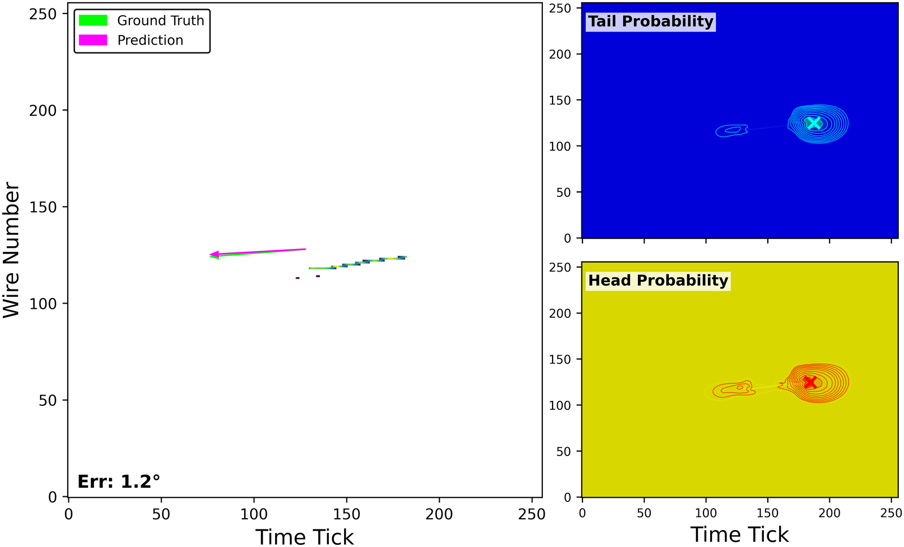

# Gallery: two-point DSNT outputs

Each example shows one processed event in one wire-plane view after the muon and its Bragg peak have been removed.

* **left panel:** predicted direction (magenta) against the true initial direction (green), with the angular error;
* **right panels:** the Point A (tail) and Point B (head) probability maps, with **×** marking each DSNT expectation.

The predicted direction is $`\mathbf{r}_B - \mathbf{r}_A`$. Click any image for full resolution. Where available, *original readout* shows the same prediction drawn on the event before the muon was removed. For how the two points are trained, see [models & losses](models_and_losses.md#headtail-model).

<!-- GALLERY:START -->
<table><tr><td valign="top"> <b>Event 01771 · Z view</b> · <a href="../assets/gallery/event_01771_Z_original.png">original readout</a> Clean single-track Michel electron. The tail and head heatmaps overlap but peak at different places, and the predicted direction is 1.2° from truth.</td></tr></table>
<!-- GALLERY:END -->

---
